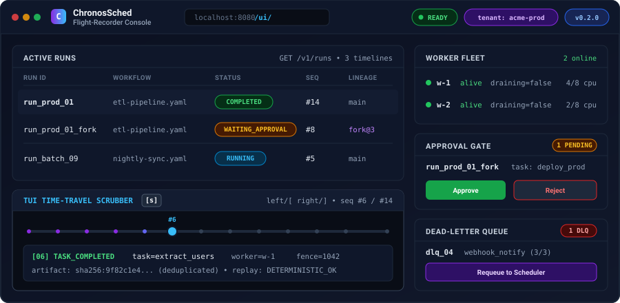
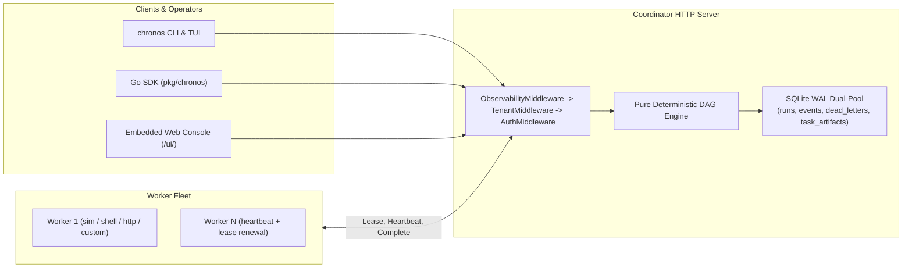

# ChronosSched

**Deterministic distributed workflow scheduler and interactive execution flight recorder in a single Go binary.**

[](https://github.com/creova-gif/chronos-sched/actions/workflows/ci.yml)
[](CHANGELOG.md)
[](go.mod)
[](LICENSE)
[](docs/api/openapi.yaml)

ChronosSched combines multi-worker DAG execution with an append-only event journal, live crash recovery, side-effect-free deterministic replay, and Git-style timeline branching (`fork`, `diff`, `merge`) — with zero mandatory external infrastructure (no Postgres, Redis, or Kafka).



---

## Overview & Key Features

- **Deterministic Event Journal & Replay:** Every state transition is persisted to an append-only SQLite WAL event journal with monotonic `fencing_token` values, enabling offline `history`, `inspect-at`, and side-effect-free `replay`.
- **Git-Style Fork, Diff & Merge:** Branch an isolated timeline from any checkpoint with parameter overrides (`fork`), compare execution divergence (`diff`), cherry-pick or merge task outcomes (`merge`), and inspect lineage (`branches`).
- **Programmable Scheduling & Worker Graceful Drain:** Resource-aware task placement (`--resources cpu=4,mem_mb=1024`), deterministic cron schedules (`schedule`), active-standby coordinator HA leader leases (`--ha-id`), and zero-drop `worker drain`.
- **Human-in-the-Loop Approval Gates:** Pause DAG progression on gated tasks until an operator approves or rejects via `chronos approve` or the Coordinator API.
- **Content-Addressed Task Artifacts:** Store and deduplicate task outputs by SHA-256 in SQLite (`artifacts list|get|put`) while keeping journal events lightweight.
- **Dead-Letter Queue (`dlq`):** Exhausted retries are routed to `dead_letters` for inspection (`dlq list`) and safe operator requeueing (`dlq requeue`).
- **Multi-Tenant Isolation & Auth:** Namespace isolation via `X-Chronos-Tenant` and optional Bearer token authentication (`--auth-token` / `CHRONOS_AUTH_TOKEN`), plus structured `slog` logging and W3C `traceparent` propagation.
- **Embedded Web Console (`/ui/`):** Zero-dependency flight-recorder web UI served directly by the coordinator for inspecting runs, DAGs, events, artifacts, approvals, and DLQ entries.
- **Interactive Bubbletea TUI:** Live terminal dashboard (`chronos demo`) with a built-in Time-Travel Scrubber (`[s]`) to step backward and forward through recorded checkpoints.

---

## Architecture



---

## Installation

### Build from source

```bash
git clone https://github.com/creova-gif/chronos-sched.git
cd chronos-sched
go build -o chronos ./cmd/chronos
```

### Install via `go install`

```bash
go install github.com/creova-gif/chronos-sched/cmd/chronos@latest
```

### Run with Docker Compose

```bash
docker compose up --build
```

---

## Quick Start & Usage

### 1. Self-Contained Live TUI Demo

Run the embedded 100-task DAG with 5 local workers and press `[s]` in the TUI to open the Time-Travel Scrubber:

```bash
chronos demo --workers 5
```

### 2. Coordinator, Workers & Workflow Lifecycle

```bash
# Start the coordinator (serves API + embedded Web Console at http://127.0.0.1:7420/ui/)
chronos server start --addr 127.0.0.1:7420 --db .chronos/chronos.db

# Start workers, list active fleet, or gracefully drain a worker
chronos worker start --coordinator http://127.0.0.1:7420 --concurrency 8 --resources cpu=4,mem_mb=1024
chronos worker list
chronos worker drain worker-1

# Submit, inspect, pause, resume, or cancel a workflow run
chronos workflow run pipeline.yaml --run-id run_001
chronos workflow inspect run_001
chronos workflow pause run_001 && chronos workflow resume run_001
chronos workflow cancel run_001
```

### 3. Time-Travel, Branching & Flight-Recorder Bundles

```bash
# Inspect recorded execution history and replay deterministically (offline SQLite read)
chronos history run_001
chronos inspect-at run_001 --checkpoint 3
chronos replay run_001

# Fork an isolated timeline from a checkpoint, diff, merge, and inspect lineage
chronos fork run_001 --checkpoint 3 --override task.key=value
chronos diff run_001 run_002
chronos merge run_001 run_002 --prefer-branch --apply
chronos branches

# Export portable SHA-256 flight-recorder bundles and Perfetto / Chrome Trace timelines
chronos export run_001 -o crash.bundle.json
chronos import crash.bundle.json --run-id run_repro
chronos trace run_001 -o trace.json
```

### 4. Schedules, Approvals, Artifacts, DLQ & Operations

```bash
# Deterministic cron schedules
chronos schedule add nightly --cron "0 2 * * *" --workflow pipeline.yaml

# Human-in-the-loop approval gates
chronos approve run_001 deploy_prod --actor alice --comment "LGTM"

# Content-addressed task artifacts
chronos artifacts put run_001 build_step report.txt ./report.txt
chronos artifacts list run_001
chronos artifacts get run_001 build_step report.txt -o report.txt

# Dead-letter queue inspection and requeue
chronos dlq list
chronos dlq requeue 1

# Journal compaction, environment diagnostics, and build info
chronos gc --older-than 168h --dry-run
chronos doctor
chronos version
```

### 5. Embedded Web Console

When the coordinator is running (`chronos server start`), open `http://127.0.0.1:7420/ui/` in a browser to explore workflow runs, DAG topology, event timelines, task artifacts, pending approvals, and DLQ entries.

### 6. Go SDK (`pkg/chronos`)

```go
package main

import (
	"context"
	"fmt"
	"os"

	"github.com/creova-gif/chronos-sched/pkg/chronos"
)

func main() {
	ctx := context.Background()
	client := chronos.NewClient("http://127.0.0.1:7420").
		WithBearerToken(os.Getenv("CHRONOS_AUTH_TOKEN")).
		WithTenant("acme-prod")

	resp, err := client.SubmitWorkflow(ctx, "run_sdk_001", workflowYAML)
	if err != nil {
		panic(err)
	}
	snap, err := client.GetRun(ctx, resp.RunID)
	if err != nil {
		panic(err)
	}
	fmt.Printf("Run %s status=%s tasks=%d\n", snap.State.RunID, snap.State.Status, len(snap.State.Tasks))
}
```

---

## Configuration

| Flag / Header / Env | Component | Default | Description |
| :--- | :--- | :--- | :--- |
| `--addr` | `server start` | `127.0.0.1:7420` | Coordinator HTTP listen address |
| `--db` | `server start`, offline CLI | `.chronos/chronos.db` | SQLite WAL journal path |
| `--auth-token` / `CHRONOS_AUTH_TOKEN` | `server start`, `worker start`, CLI | `""` (disabled) | Optional Bearer token for Coordinator API authentication |
| `--ha-id` / `--ha-ttl` | `server start` | `""` / `5s` | Candidate ID and lease TTL for active-standby HA leader election |
| `--webhook-url` / `--webhook-secret` | `server start` | `""` | Terminal run notification webhook URL and HMAC-SHA256 signing secret |
| `X-Chronos-Tenant` | HTTP API header | `default` | Multi-tenant namespace isolation header |
| `--resources` | `worker start` | `""` | Worker resource capacity key/value map (e.g. `cpu=4,mem_mb=1024`) |

---

## Measured Local Performance (Apple M5, darwin/arm64)

- **Pure Engine (`BenchmarkSchedule100TaskDAG`):** 100-task DAG scheduled and folded in `1.14ms`–`2.02ms` (`~11–20 µs/task`).
- **Real SQLite WAL (`BenchmarkSQLiteWALDispatchAndComplete`, 200x):** `0.118 ms` p50, **`0.313 ms` p95**, `0.455 ms` p99 per lease + WAL commit + complete + checkpoint WAL cycle.
- **Worker `SIGKILL` Recovery (`TestE2EWorkerSIGKILLRecoveryUnder5Seconds`):** Real OS child worker killed via `SIGKILL`, detected and recovered under `<5s` (`1s` heartbeat, `3s` lease TTL, `250ms` reaper tick).

## Execution Guarantees

- **At-least-once task execution**, guarded by idempotency keys and monotonic `fencing_token` values.
- **Durable state transitions** committed to SQLite WAL before acknowledging progress.
- **Deterministic replay** reconstructed from recorded events without re-executing external side effects.
- **Explicit ambiguity handling** (`TASK_OUTCOME_AMBIGUOUS`) when a worker dies mid-lease before reporting completion.
- **No false exactly-once claims** for external side effects without destination cooperation.

---

## Documentation & Contributing

- [Milestone 1 Design & Engineering Review](docs/designs/chronos-sched-m1.md)
- [Milestone 4 Design: Full Product Engineering & Scope Expansion](docs/designs/chronos-sched-m4.md)
- [ADR-001: Event Journal, SQLite WAL & Fencing Model](docs/adr/001-event-journal-sqlite-fencing.md)
- [ADR-002: Programmable Scheduling Constraints](docs/adr/002-programmable-scheduling-constraints.md)
- [ADR-003: Timeline Merge & Cherry-Pick](docs/adr/003-timeline-merge-and-cherry-pick.md)
- [ADR-004: Coordinator HA Leader Lease](docs/adr/004-coordinator-ha-leader-lease.md)
- [ADR-005: Prometheus Metrics & Observability](docs/adr/005-prometheus-metrics-and-observability.md)
- [ADR-006: Deterministic Cron Schedules](docs/adr/006-deterministic-cron-schedules.md)
- [ADR-007: Flight-Recorder Bundle & Perfetto Trace](docs/adr/007-flight-recorder-bundle-and-perfetto-trace.md)
- [ADR-008: Journal Retention & Compaction](docs/adr/008-journal-retention-and-compaction.md)
- [ADR-009: Webhook Notifications & Retries](docs/adr/009-webhook-notifications-and-retries.md)
- [ADR-010: Coordinator Bearer Auth](docs/adr/010-coordinator-bearer-auth.md)
- [ADR-011: Dead-Letter Queue Requeue, Middleware & Readiness Probe](docs/adr/011-dlq-requeue-and-observability.md)
- [ADR-012: Task Artifacts and Embedded Flight-Recorder Web UI](docs/adr/012-task-artifacts-and-embedded-ui.md)
- [ADR-013: Approval Gates and Tenant Isolation](docs/adr/013-approval-gates-and-tenant-isolation.md)
- [ADR-015: Idempotency Keys, Security Headers, and Worker Connection Pooling](docs/adr/015-idempotency-and-enterprise-hardening.md)
- [OpenAPI 3.1 Specification](docs/api/openapi.yaml)
- [Threat Model](docs/THREAT_MODEL.md)
- [Security Policy](SECURITY.md)
- [Environment Configuration Example](.env.example)
- [CHANGELOG](CHANGELOG.md)
- [Contributing Guide](CONTRIBUTING.md)
- [Engineering Standards](AGENTS.md)
- [MIT License](LICENSE)
